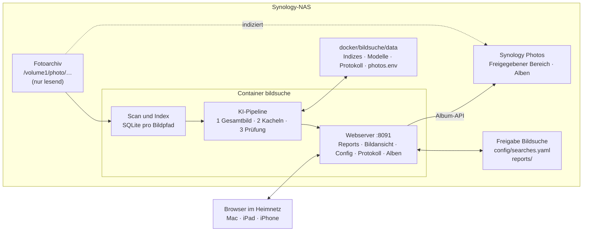

# Spezifikation

Stand: Version 2026-10-21e

## Zweck

Die Bildsuche durchsucht ein großes Fotoarchiv auf einer Synology-NAS nach frei formulierten Motiven, etwa
LEGO-Modellen, Spielszenen oder Klettersteigen. Jedes Bild wird **einmal** von KI-Modellen „angeschaut“ und als
Vektor gespeichert. Danach kostet ein neuer oder geänderter Suchbegriff nur Sekunden. Die Ergebnisse erscheinen als
Webseite im Heimnetz und lassen sich in Alben von Synology Photos übernehmen.

Entwickelt und betrieben auf einer DS425+ (Intel J4125, 4 Kerne ohne AVX, 18 GB RAM, DSM 7.3) mit rund
200.000 Bildern (HEIC, JPG, wenige RAW).

## Architektur

Alles läuft in **einem** Container. Er liest das Archiv nur, hält Index und Modelle in eigenen Ordnern und spricht
Synology Photos nur an, wenn ein Album angelegt oder gelöscht wird.

| Komponente | Technik |
|---|---|
| Laufzeit | Python 3.11, PyTorch (CPU), open_clip, Pillow, pillow-heif, rawpy, NumPy, PyYAML |
| Index | SQLite, Embeddings als float16, im Betrieb komplett im RAM |
| Webserver | Python `http.server` (ThreadingHTTPServer), statische Reports + kleine JSON-API |
| Album-Anbindung | inoffizielle Synology-Photos-Web-API (`SYNO.Foto.*`, `SYNO.FotoTeam.*`) |

## Suchverfahren

| Stufe | Modell | Berechnet | Bilder | Tempo (DS425+) |
|---|---|---|---|---|
| 1 Gesamtbild | `xlm-roberta-base-ViT-B-32` (LAION-5B), mehrsprachig | ein Vektor pro Bild | alle | ca. 1 Tag / 200.000 |
| 2 Kacheln | dasselbe Modell | 4 überlappende Viertel (je 60 %) | alle, wahrscheinlichste zuerst | ca. 0,3 Bilder/s |
| 3 Prüfung | `ViT-B-16-SigLIP2-384` (WebLI) | Ganzbild (aufgefüllt) + 4 Viertel, 384 px | nur Kandidaten | ca. 20 s pro Bild |

**Reihenfolge:** Stufe 1 → Prüfung der Kandidaten → Kacheln. Neue Kandidaten aus den Kacheln werden sofort geprüft;
die Prüfung hat Vorrang.

**Scoring:** Softmax über Suchbegriff (Mittel aller Formulierungen) gegen die Gegenkategorien, skaliert mit dem
`logit_scale` des Modells. Grob-Score = Maximum aus Gesamtbild und bester Kachel; Prüf-Score = Maximum über die fünf Ausschnitte.

| Status | Bedeutung |
|---|---|
| Bestätigt | geprüft, Prüf-Score ≥ `threshold` |
| Vorläufig | noch nicht geprüft, Grob-Score ≥ `coarse_threshold` |
| Verworfen | geprüft, Prüf-Score < `threshold` |

**Gegenkategorien:** Hat eine Suche eigene `negatives`, **ersetzen** diese die `default_negatives`.

**Adaptive Kandidatenmenge:** Geprüft werden mindestens die besten `candidates` Bilder. Solange von den letzten 500
geprüften mindestens `expand_if_rate` (2 %) bestätigt werden, wächst die Menge um `expand_step` (1000), höchstens bis
`candidates_max`. So werden auch Treffer gefunden, die das schnelle Modell unterschätzt.

**Ähnliche Bilder:** Serienbilder und Kopien (Kosinus-Ähnlichkeit ≥ `dedupe_similarity`) werden im Report zu einem
Motiv „+n ähnliche“ gebündelt; die CSV enthält alle mit Verweis in `aehnlich_wie_rang`.

**Änderung einer Suche:** Der Index enthält nur suchunabhängige Bild-Vektoren. Nach dem Speichern werden alle Scores in
Sekunden neu berechnet und der Report vollständig neu aufgebaut; bereits geprüfte Bilder behalten ihren Prüf-Vektor
(suchübergreifend). Nur neu hinzugekommene Kandidaten müssen geprüft werden.

## Index

- **Ein Index pro Bildpfad:** `data/indexes/<pfad-slug>_<sha1-8>.sqlite`. Ein neuer `photo_root` legt einen weiteren
  Index an; beim Zurückwechseln wird der vorhandene weiterbenutzt.
- **Inhalt:** relative Pfade, Größe und Änderungszeit, Embeddings (Gesamtbild, Kacheln, Prüfung), Lesefehler.
  Suchbegriffe stehen nicht im Index.
- **Scan:** beim Start, alle `rescan_interval_hours` (6) und bei Pfadwechsel. Neue, geänderte und verschwundene Bilder
  werden erkannt und mit Namen protokolliert.
- **Ausgelassen:** `exclude_dirs` (u. a. `@eaDir`, `#recycle`, `#snapshot`), Dateien unter `min_file_kb`,
  RAW-Dateien mit gleichnamigem JPG/HEIC daneben.
- **Schutz:** Fehlen bei einem Scan mehr als max(1000, 30 %) der bekannten Bilder, wird der Index nicht bereinigt
  (falsche Konfiguration, nicht eingebundenes Laufwerk).
- **Reihenfolge:** zufällig, damit Zwischen-Reports Stichproben aus allen Jahren sind.
- **Offline:** Nach dem ersten erfolgreichen Modell-Download startet der Container ohne Internetzugriff.

## Konfiguration (`searches.yaml`)

Änderungen wirken nach ca. 30 Sekunden, ohne Neustart. Fehlt ein Wert, gilt der eingebaute Standard.

### Einstellungen (`settings`)

| Parameter | Standard | Bedeutung |
|---|---|---|
| `photo_root` | `/volume1/photo/Bildarchiv` | zu durchsuchender Ordner (NAS-Pfad) |
| `rescan_interval_hours` | 6 | Abstand der Scans |
| `report_minutes` | 20 | Zwischen-Report während der Berechnung |
| `batch_size` | 16 | Bilder pro Rechenschritt |
| `exclude_dirs` | `@eaDir`, `#recycle`, … | übersprungene Ordner |
| `min_file_kb` | 20 | kleinere Dateien ignorieren |
| `skip_raw_with_sibling` | true | RAW überspringen, wenn JPG/HEIC daneben liegt |
| `random_order` | true | zufällige Reihenfolge |
| `dedupe_similarity` | 0,95 | Bündelung ähnlicher Bilder, 0 = aus |
| `tiles` / `rerank` | true / true | Stufe 2 / 3 an oder aus |
| `rerank_model` / `rerank_pretrained` | `ViT-B-16-SigLIP2-384` / `webli` | Modell der Prüfung |
| `preview_max` | 300 | vorläufige Treffer als Bild im Report |
| `expand_if_rate` / `expand_step` / `candidates_max` | 0,02 / 1000 / 30000 | adaptive Kandidatenmenge |
| `web_base` | `http://diskstation.local:8091` | Adresse der Webseite (Links in der CSV) |
| `photos_url` | `http://192.168.1.10:5000` | DSM-Adresse für die Album-API (IP) |
| `photos_folder_prefix` | `auto` | Ordner in Photos; `auto` = `photo_root` ohne `photos_share_path` |
| `photos_share_path` | `/volume1/photo` | Freigabe hinter dem Freigegebenen Bereich |
| `photos_share_with` | `[]` | Benutzer, mit denen Alben geteilt werden |
| `photos_share_role` | `manage` (Beispielkonfiguration: `download`) | Rolle beim Teilen |
| `photos_album_prefix` | `"Bildsuche: "` | Vorbelegung des Albumnamens |
| `default_negatives` | allgemeine Motive | Gegenkategorien ohne eigene Liste |

### Suchen (`searches`)

| Feld | Bedeutung |
|---|---|
| `name` | Name, zugleich Ordner des Reports |
| `terms` | mehrere Formulierungen, werden gemittelt |
| `negatives` | optional, ersetzt `default_negatives` |
| `threshold` | Schwelle für „Bestätigt“ (Prüf-Score) |
| `coarse_threshold` | Schwelle für „Vorläufig“ (Grob-Score) |
| `candidates` | Mindestzahl geprüfter Kandidaten |
| `max_results` | bestätigte Motive als Bild im Report (CSV: alle) |
| `candidates_max` | optional, Obergrenze nur für diese Suche |

## Webseite

Port 8091, ohne Passwort. Abschalten: `WEB_PORT=0` in `compose.yaml`.

| Seite / Endpunkt | Inhalt |
|---|---|
| `/` | Übersicht: Bildpfad, Fortschritt, Suchen, Indizes, ältere Reports mit Löschknopf |
| `/<suche>/report.html` | Treffer als Vorschaubilder, Album-Kasten, Auswahl per Klick / Umschalt-Klick |
| `/<suche>/results.csv` | alle Treffer (Semikolon, deutsches Komma) |
| `/bild?s=&p=` | Originalbild, HEIC/RAW als JPEG; nur Bilder aus dem Report dieser Suche |
| `/config`, `/api/config` | Editor für `searches.yaml` mit Prüfung und Sicherung (letzte 10) |
| `/protokoll`, `/protokoll.txt` | Programmprotokoll, neueste oben, Filter, Download |
| `/api/album`, `/api/album/status` | Album-Aufträge |
| `/api/report/delete` | Löschen eines älteren Reports (nicht für aktive Suchen) |

**Bildansicht:** „Bild öffnen“ zeigt das Bild groß über dem Report (auch als iPad-Web-App), Blättern per Wischen,
Pfeilen oder Tastatur, „Auswählen“ fürs Album, Schließen per ✕, Esc oder Zurück-Geste.

**Reports** entstehen beim Start, alle `report_minutes` und nach jeder Konfigurationsänderung; sie werden atomar
geschrieben. Reports von Suchen, die nicht mehr existieren, erscheinen auf der Übersicht unter „Ältere Reports“.

**Protokoll:** zusätzlich zur Containerausgabe in `data/logs/bildsuche.log` (rotierend, 6 × 2 MB), inklusive Abstürzen
und Webserver-Fehlern. Nur im Container Manager: Build-Ausgaben, Download-Fortschritt, harte Abbrüche von außen.

## Synology-Photos-Alben

Bedienung im Album-Kasten jeder Report-Seite:

- **Alle bestätigten hinzufügen** oder **Auswahl hinzufügen**; „ähnliche Bilder mitnehmen“ ist optional
- **Probelauf (5 Bilder)** legt „Bildsuche-Test: …“ an
- **Album löschen** (mit Rückfrage) – nur Alben, die die Bildsuche selbst angelegt hat; Fotos bleiben erhalten

Ablauf:

1. Pfade aus `results.csv` (bei Auswahl nur Pfade, die im Report stehen)
2. Anmeldung über `SYNO.API.Auth` mit `session=webui` (andere Session-Namen liefern Fehler 402)
3. Ordner im Freigegebenen Bereich Ebene für Ebene suchen (`SYNO.FotoTeam.Browse.Folder`), Bilder auflisten (`…Browse.Item`)
4. Zuordnung: exakter Dateiname → ohne Groß-/Kleinschreibung → Namensstamm (RAW+JPG, Live-Fotos)
5. Existiert das Album, werden Bilder **hinzugefügt**, nie entfernt; sonst wird es angelegt
6. Teilen mit `photos_share_with` und `photos_share_role`; lehnt Photos die Rolle ab, schrittweise schwächer
   (manage → upload → download → view)
7. Meldung mit Anzahl und bis zu drei nicht gefundenen Dateien (vollständige Liste im Protokoll)

**Rollen:** Ein Album gehört immer dem Benutzer, der es anlegt, und lässt sich nicht übergeben. Löschen kann nur der
Besitzer.

| Rolle | Geteilter Benutzer kann |
|---|---|
| `view` | ansehen, Diashow – nicht auswählen |
| `download` | auswählen, herunterladen, in eigenes Album übernehmen (Kopiervorlage) |
| `manage` | Bilder im Album hinzufügen und entfernen, aber das Album nicht löschen |

**Vorsicht:** Das Menü „Löschen“ für die Foto-*Datei* hängt an den Ordnerrechten des Benutzers in Photos, nicht an der
Album-Rolle, und erscheint daher auch in geteilten Alben. Schutz: Papierkorb der Freigabe `photo` aktivieren.

## Berechtigungen und Sicherheit

- Eigener DSM-Benutzer für die Alben (nur `users`, Freigabe `photo` schreibgeschützt, nur Synology Photos);
  Zugangsdaten nur in `data/photos.env`.
- **Ordnerrechte in Photos setzen:** Synology Photos führt eine eigene Rechte-Datenbank und schreibt die ACLs selbst.
  Der Hilfsbenutzer braucht „Anzeigen“ für den Bildordner **und jeden Unterordner**. Änderungen per `synoacltool`
  erreichen nur das Dateisystem, nicht Photos; `synoacltool -enforce-inherit` kann bestehende Listen ersetzen.
- Archiv und Programmcode sind im Container nur lesend eingebunden.
- `/bild` liefert nur Bilder aus Reports aus, kein Durchstöbern von Ordnern.
- Die Webseite hat keinen Passwortschutz und gehört nur ins Heimnetz.

## Betrieb

| Thema | Umsetzung |
|---|---|
| Priorität | `cpu_shares: 256` (der Synology-Kernel unterstützt keine harte CPU-Grenze per `cpus:`) |
| Threads | `THREADS=4`, weniger Last mit `THREADS=2` |
| Speicher | `mem_limit: 7g` (beide Modelle + Index im RAM) |
| Neustart | `restart: unless-stopped`; Code wird aus `app/` eingebunden, Update = Datei ersetzen + Neustart |
| Datensicherung | Papierkorb für `photo`, Hyper Backup; verschwundene Bilder stehen mit Namen im Protokoll |

## Bekannte Grenzen

- Die Prüfung mit SigLIP 2 ist auf einer CPU ohne AVX teuer (ca. 20 s pro Bild); große Kandidatenmengen halten die
  Kacheln tagelang auf.
- Erkennung ist statistisch: Schwellen und Gegenkategorien sind je Suche einzustellen; ähnliche Motive
  (Berg mit Mensch statt Klettersteig) werden mitunter bestätigt.
- Die Album-Funktion nutzt eine inoffizielle API und kann nach Updates von Synology Photos brechen –
  nach Updates zuerst den Probelauf testen.
- Bilder außerhalb des Freigegebenen Bereichs lassen sich durchsuchen, aber nicht in Alben übernehmen.
